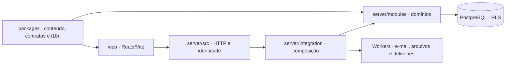

# Arquitetura do OrgMap

OrgMap é um monorepo TypeScript, com frontend React/Vite e um servidor Fastify/PostgreSQL organizado em módulos de domínio. A composição do servidor liga os módulos por ports e contratos; cada domínio mantém suas tabelas, regras e autorização.

## Mapa do código

| Pasta | Dono / papel |
| --- | --- |
| `web/src/App.tsx` | Rotas, sessão e composição do shell principal. |
| `web/src/features/` | Interfaces dos módulos de domínio. |
| `web/src/account/`, `accessibility/`, `localization/`, `editor/` | Capacidades compartilhadas da interface. |
| `web/src/*Shell*`, `*Menu*`, `Structure*` | Shell, navegação e exploração da estrutura. |
| `web/public/` | Marca, fontes e assets servidos pelo app. |
| `server/src/` | Fundação HTTP, identidade, persistência e migrations. |
| `server/modules/` | Regras e serviços de domínio. |
| `server/integration/` | Adapters, ports entre módulos e launchers. |
| `server/ops/` | Backup, recuperação e vínculo de host/dados. |
| `server/iam-mail/` | Fila e worker de mensagens da conta. |
| `server/migrations/` | SQL versionado e checkpoints revisados. |
| `packages/content/` | Documento rico, validação, renderer e colaboração. |
| `packages/contracts/` | Contratos compartilhados. |
| `packages/i18n/` | Localização e mensagens compartilhadas. |

## Domínios

| Servidor | Interface | Responsabilidade |
| --- | --- | --- |
| `structure` | Exploração + `structure-advanced` | Círculos, papéis, definições, vínculos e estrutura. |
| `governance` | `governance` | Tensões, propostas, restrições, rodadas e decisões. |
| `o2` | `o2` + painel de reuniões | Pacote O2, papéis essenciais e processo. |
| `work` | `work` | Projetos, tarefas, vistas, recursos e participação. |
| `meetings` | `meetings` | Agendamento, pauta, condução e atas. |
| `administration` | `administration` | Organização, configuração, aparência e publicação. |
| `platform` | `platform` | Pesquisa, arquivos, notificações e jobs transversais. |
| `goals` | `goals` | Objetivos, indicadores e progresso. |
| `interoperability` | `interoperability` | Federação, APIs e integrações. |

## Limites a preservar

- **Organização e identidade:** sessão e contexto de organização precisam ser revalidados. RLS/ACL do servidor são a autoridade; visibilidade na UI não concede permissão.
- **Dados de domínio:** acesse outro módulo pelo port/adapter da composição. Evite SQL cruzado ou duplicar suas regras no frontend.
- **Migrations:** acrescente arquivos novos; não reescreva SQL já aplicado nem os checksums revisados para contornar um upgrade.
- **Conteúdo rico:** use `packages/content` e os componentes de `web/src/editor`; não trate HTML arbitrário como documento válido.
- **Visual:** use os tokens de [Maré](../DESIGN.md) e o tema da organização. Evite cores fixas ou novos estilos paralelos de botão, modal e navegação.
- **Estado local:** `.orgmap/`, dependências, builds, credenciais e dados de execução são ignorados pelo Git.

## Encontrar o lugar certo para uma alteração

Parta da rota em `App.tsx` e do módulo em `web/src/features`. Siga seu cliente HTTP até o plugin do módulo em `server/modules`, depois serviço/port e migrations. Contratos de cada módulo ficam próximos do código. Consulte o [guia de testes](testing.md).
